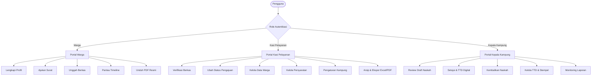
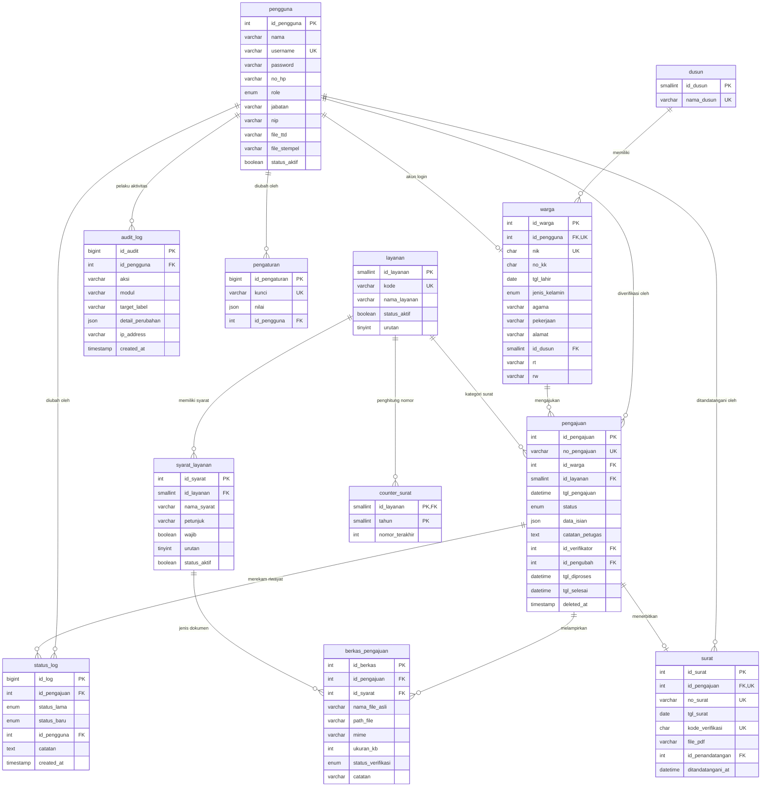
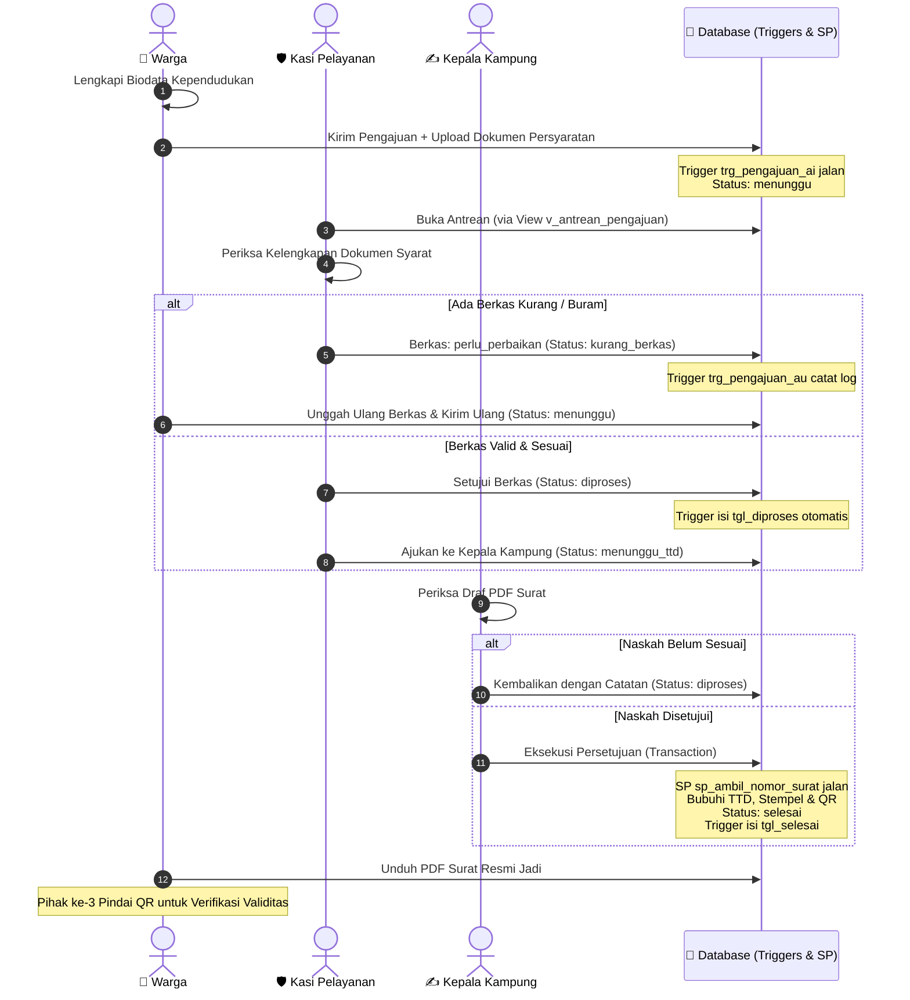

# 🏛️ SIRUKTI — Sistem Layanan Surat Digital Kampung Rukti Harjo

[](https://laravel.com)
[](https://php.net)
[](https://mysql.com)
[](https://tailwindcss.com)
[](https://alpinejs.dev)
[](https://web.dev/progressive-web-apps/)

**SIRUKTI** (*Sistem Informasi Layanan Surat Digital Kampung Rukti Harjo*) adalah platform tata kelola persuratan desa berbasis web responsif (*mobile-first*) dan PWA (*Progressive Web App*). Sistem ini dirancang untuk memodernisasi pelayanan administrasi kependudukan di Kantor Balai Desa Kampung Rukti Harjo, Kecamatan Seputih Raman, Kabupaten Lampung Tengah.

Proyek ini dibangun dari nol (*scratch*) sebagai tugas proyek **Ujian Tengah Semester (UTS) Mata Kuliah Basis Data Lanjut (Semester 5)** dengan melakukan rancang ulang (*refactor & overhaul*) sistem skripsi sebelumnya guna mengimplementasikan struktur basis data relasional yang ternormalisasi (3NF), integritas data yang kokoh, dan objek basis data terprogram tingkat lanjut (**Triggers, Stored Procedures, Views, Check Constraints, Database Transactions, dan Audit Trails**).

---

## 📑 Daftar Isi

- [1. Latar Belakang & Konteks Akademik](#1-latar-belakang--konteks-akademik)
- [2. Perbandingan dengan Sistem Lama (Skripsi)](#2-perbandingan-dengan-sistem-lama-skripsi)
- [3. Fitur Utama Sistem](#3-fitur-utama-sistem)
- [4. Hak Akses & Peran Pengguna (Role)](#4-hak-akses--peran-pengguna-role)
- [5. Arsitektur Basis Data Lanjut (Core Database Engine)](#5-arsitektur-basis-data-lanjut-core-database-engine)
  - [5.1 Entity Relationship Diagram (ERD)](#51-entity-relationship-diagram-erd)
  - [5.2 Struktur 12 Tabel Sistem](#52-struktur-12-tabel-sistem)
  - [5.3 Database Triggers](#53-database-triggers)
  - [5.4 Stored Procedures](#54-stored-procedures)
  - [5.5 Database Views](#55-database-views)
  - [5.6 Check Constraints & Data Integrity](#56-check-constraints--data-integrity)
  - [5.7 Database Transactions & Concurrency](#57-database-transactions--concurrency)
  - [5.8 Audit Trail Logging](#58-audit-trail-logging)
- [6. Alur Kerja Sistem (Business Process & State Machine)](#6-alur-kerja-sistem-business-process--state-machine)
- [7. Spesifikasi Teknologi (Tech Stack)](#7-spesifikasi-teknologi-tech-stack)
- [8. Panduan Instalasi & Deployment](#8-panduan-instalasi--deployment)
- [9. Akun Pengujian (Demo Credentials)](#9-akun-pengujian-demo-credentials)
- [10. Struktur Direktori Proyek](#10-struktur-direktori-proyek)
- [11. Pengujian Kualitas & Keamanan (QA & Testing)](#11-pengujian-kualitas--keamanan-qa--testing)
- [12. Berkas & Dokumentasi Pendukung](#12-berkas--dokumentasi-pendukung)

---

## 1. Latar Belakang & Konteks Akademik

Kampung Rukti Harjo memiliki populasi sekitar 5.990 jiwa dan 1.780 Kepala Keluarga (KK). Dalam operasional hariannya, Balai Desa melayani permohonan berbagai surat keterangan kependudukan (SKCK, SKTM, Domisili, SKU). Pelayanan konvensional menghadapi berbagai kendala:
1. **Pencatatan Buku Besar Manual:** Rawan hilang, rusak, dan pencarian arsip lama membutuhkan waktu lama.
2. **Warga Bolak-Balik:** Ketidaktahuan warga mengenai kelengkapan dokumen persyaratan dan ketiadaan notifikasi status perbaikan berkas.
3. **Surat Dibuat Manual:** Penomoran sering tumpang tindih (*race condition*) dan surat rentan dipalsukan karena tidak memiliki mekanisme verifikasi digital.
4. **Rekapitulasi Lambat:** Penyusunan laporan bulanan dan tahunan untuk kecamatan memakan waktu berhari-hari.

Sistem ini dikembangkan mengacu pada studi empiris dari skripsi terdahulu (*"Rancang Bangun Sistem Layanan Masyarakat Berbasis Web di Balai Desa Rukti Harjo"*, 2025) dengan memperbaiki seluruh celah perancangan basis data, alur bisnis, serta menghadirkan antarmuka *mobile-first* yang ramah bagi warga desa.

---

## 2. Perbandingan dengan Sistem Lama (Skripsi)

| Aspek Penilaian | Sistem Skripsi Terdahulu | SIRUKTI (Basis Data Lanjut) |
|---|---|---|
| **Arsitektur Basis Data** | 4 Tabel tidak terstandar (`users`, `layanan`, `pengajuan`, `berkas_pengajuan`) | **12 Tabel Ternormalisasi (3NF)** terhubung relasi integritas referensial penuh |
| **Objek Terprogram (Database Objects)** | Tidak ada (0 Trigger, 0 SP, 0 View) | **3 Database Triggers**, **2 Stored Procedures**, **2 Database Views** |
| **Integritas Data** | Mengandalkan validasi aplikasi saja | **CHECK Constraints** (regex NIK 16 digit, No KK, ukuran file > 0, counter >= 0) + Relasi FK Restrict/Cascade |
| **Log Riwayat Status** | Tidak ada riwayat perubahan status | **Otomatis via Database Trigger** ke tabel `status_log` (mencatat pelaku & catatan waktu) |
| **Audit Jejak Keamanan** | Tidak ada jejak audit | **Tabel `audit_log`** mencatat aksi kritis petugas (IP, waktu, modul, detail perubahan aman) |
| **Penomoran Surat** | Dibuat manual oleh petugas | **Otomatis & Atomik via Stored Procedure** (`sp_ambil_nomor_surat`) dengan penguncian baris (`FOR UPDATE`) |
| **Verifikasi Berkas** | Penilaian global per pengajuan | **Granular per berkas persyaratan** (Sesuai / Perlu Perbaikan + alasan spesifik) |
| **Penerbitan Surat** | Dokumen diunggah manual | **Render PDF Otomatis (DomPDF)** lengkap dengan Cap Stempel Desa, TTD Digital, & QR Code Verifikasi |
| **Verifikasi Keaslian** | Tidak ada validasi publik | **Halaman Verifikasi Publik via QR Code** dengan token acak 32-karakter dan proteksi privasi NIK |
| **Aksesibilitas Perangkat** | Berorientasi Desktop | **Mobile-First & PWA Installable** (ramah smartphone warga Android/iOS) |
| **Penghapusan Arsip** | *Hard delete* (kehilangan jejak permanen) | **Soft Deletes** (`deleted_at`) terintegrasi pada query & laporan rekapitulasi |

---

## 3. Fitur Utama Sistem

### 🌐 Halaman Publik & Pelayanan Cepat
- **Landing Page Informatif:** Informasi profil kampung, jam kerja dinamis, panduan 4 langkah, syarat layanan transparan, dan FAQ.
- **Lacak Cepat Pengajuan:** Pengecekan progres permohonan surat hanya dengan memasukkan Nomor Pengajuan (`PG-YYYYMMDD-XXXX`) tanpa wajib login.
- **Verifikasi Keaslian Surat (Scan QR):** Pindai QR Code pada lembar surat fisik untuk membuktikan keabsahan dokumen (nomor surat, penandatangan, jenis layanan, tanggal terbit, NIK disamarkan demi privasi).
- **Progressive Web App (PWA):** Dapat diinstal langsung ke layar utama *smartphone* (*Add to Home Screen*) dengan performa cepat (*Service Worker network-first*).

### 👤 Portal Mandiri Warga
- **Registrasi & Manajemen Akun:** Pendaftaran ringkas dengan NIK 16 digit, nomor WhatsApp, serta opsi username unik.
- **Kelengkapan Profil Kependudukan:** Form data diri lengkap (Dusun, RT/RW, No. KK, Agama, Pekerjaan) dengan validasi sebelum pengajuan pertama.
- **Wizard Pengajuan Surat 4 Langkah:**
  1. *Pilih Layanan* (SKCK, Domisili, SKTM, SKU).
  2. *Isi Data Spesifik Layanan* (Keperluan, Nama Usaha, Penghasilan, dll).
  3. *Unggah Berkas Persyaratan* (Kamera HP langsung / Galeri foto dengan kompresi gambar otomatis di browser).
  4. *Tinjau & Kirim Pengajuan*.
- **Penyimpanan Draf Otomatis (Anti-Hilang):** Isian form tersimpan di `localStorage` per pengguna jika koneksi terputus.
- **Timeline Status Real-Time:** Pelacakan status transparan dengan riwayat petugas verifikator dan pembaruan otomatis tanpa reload.
- **Alur Perbaikan Berkas:** Mengganti hanya dokumen yang dinilai *Perlu Perbaikan* tanpa mengulang pengajuan baru.
- **Unduh Surat Digital:** Mengunduh dokumen resmi format PDF langsung setelah disetujui Kepala Kampung.
- **Pencarian Riwayat Cepat:** Pencarian nomor surat / nomor pengajuan berbasis AJAX (tanpa refresh halaman).

### 🛡️ Portal Kasi Pelayanan (Verifikator & Operator)
- **Antrean Verifikasi Responsif:** Tampilan kartu antrean di smartphone dan tabel komprehensif di desktop dengan filter multi-kriteria.
- **Verifikasi Berkas Granular:** Pratinjau berkas (PDF/Gambar), penandaan status per berkas dengan preset saran cepat alasan revisi.
- **Pratinjau Draf Surat:** Pemeriksaan draft naskah dinas sebelum diajukan ke meja Kepala Kampung.
- **Hubungi Pemohon via WhatsApp:** Tombol 1-klik terintegrasi template pesan WhatsApp otomatis ke nomor warga.
- **Kelola Warga:** Pencarian warga, perbaikan biodata kependudukan, reset kata sandi darurat, dan aktivasi/nonaktivasi akun.
- **Konfigurasi Persyaratan Layanan:** Pengaturan dokumen syarat (wajib/opsional, urutan, status aktif) per jenis surat.
- **Pengaturan Profil Kampung:** Pengaturan kop surat resmi, jam operasional, data kontak, dan kode penomoran surat.
- **Arsip, Rekapitulasi, & Ekspor:** Laporan bulanan/tahunan (PDF cetak & Ekspor Excel/CSV UTF-8 BOM) serta rekam jejak log aktivitas.

### ✍️ Portal Kepala Kampung (Approval & Tanda Tangan)
- **Meja Persetujuan Surat:** Antrean naskah surat berstatus `menunggu_ttd` dilengkapi pratinjau dokumen PDF terpadu.
- **Persetujuan & Tanda Tangan 1-Klik:** Eksekusi transaksi basis data untuk penerbitan nomor urut resmi, pembubuhan TTD digital, stempel cap desa transparan, dan QR verifikasi.
- **Pengembalian Berkas Bermasalah:** Mengembalikan surat ke Kasi Pelayanan dengan catatan revisi wajib.
- **Manajemen TTD & Stempel Resmi:** Pengaturan mandiri aset tanda tangan digital dan cap stempel resmi desa dengan proteksi penyimpanan privat.

---

## 4. Hak Akses & Peran Pengguna (Role)



---

## 5. Arsitektur Basis Data Lanjut (Core Database Engine)

Sistem mengadopsi standar perancangan basis data relasional tingkat lanjut yang dirancang untuk menjamin integritas referensial, konsistensi data (ACID), dan performa tinggi.

### 5.1 Entity Relationship Diagram (ERD)



---

### 5.2 Struktur 12 Tabel Sistem

1. **`dusun`**: Master data wilayah dusun di Kampung Rukti Harjo.
2. **`pengguna`**: Entitas akun login untuk semua tingkatan hak akses (`warga`, `kasi`, `kepala`), menyimpan credential hash, NIP, aset TTD, dan stempel cap desa.
3. **`warga`**: Profil identitas penduduk pemohon (relasi 1-to-1 dengan `pengguna`) yang menyimpan data KTP/KK secara terpisah.
4. **`layanan`**: Master data 4 layanan perizinan/surat desa (`SKCK`, `DOM`, `SKTM`, `SKU`).
5. **`syarat_layanan`**: Daftar dokumen persyaratan per layanan (bisa disetel wajib/opsional).
6. **`pengajuan`**: Master transaksi pengajuan surat, menyimpan riwayat status, data isian dinamis (JSON), verifikator, serta mendukung *soft delete*.
7. **`berkas_pengajuan`**: Berkas fisik yang diunggah warga untuk tiap syarat layanan beserta status penilaian per berkas.
8. **`status_log`**: Tabel riwayat status pengajuan (*audit log timeline*) yang diisi otomatis **hanya oleh database trigger**.
9. **`counter_surat`**: Tabel penghitung urut nomor surat per layanan per tahun (PK Komposit: `id_layanan` + `tahun`).
10. **`surat`**: Dokumen surat resmi final yang telah ditandatangani Kepala Kampung beserta token verifikasi QR unik (32 karakter).
11. **`pengaturan`**: Konfigurasi dinamis profil desa, jam operasional, statistik, dan format penomoran surat (disimpan dalam format JSON).
12. **`audit_log`**: Catatan jejak audit aktivitas aparatur desa untuk menjamin kepatuhan, akuntabilitas, dan keamanan sistem informasi.

---

### 5.3 Database Triggers

Sistem menggunakan **3 trigger utama** pada tabel `pengajuan` untuk mengotomatisasi pencatatan log dan menjaga aturan bisnis di level *database engine*:

#### 1. Trigger `trg_pengajuan_ai` (AFTER INSERT)
Otomatis menyisipkan entri ke tabel `status_log` saat pengajuan baru pertama kali dibuat oleh warga tanpa perlu query manual dari aplikasi.
```sql
CREATE TRIGGER trg_pengajuan_ai AFTER INSERT ON pengajuan
FOR EACH ROW
BEGIN
    INSERT INTO status_log (id_pengajuan, status_lama, status_baru, id_pengguna, catatan)
    VALUES (NEW.id_pengajuan, NULL, NEW.status, NEW.id_pengubah, 'Pengajuan dibuat');
END
```

#### 2. Trigger `trg_pengajuan_bu` (BEFORE UPDATE)
Menolak perubahan status pada permohonan yang sudah final (`selesai` atau `ditolak`) menggunakan `SIGNAL SQLSTATE '45000'`, serta mencatat stempel waktu otomatis (`tgl_diproses` dan `tgl_selesai`).
```sql
CREATE TRIGGER trg_pengajuan_bu BEFORE UPDATE ON pengajuan
FOR EACH ROW
BEGIN
    -- Mencegah manipulasi status final
    IF OLD.status IN ('selesai','ditolak') AND NEW.status <> OLD.status THEN
        SIGNAL SQLSTATE '45000'
            SET MESSAGE_TEXT = 'Pengajuan berstatus final tidak dapat diubah statusnya';
    END IF;
    
    -- Catat waktu mulai diproses
    IF NEW.status = 'diproses' AND OLD.status <> 'diproses' AND NEW.tgl_diproses IS NULL THEN
        SET NEW.tgl_diproses = NOW();
    END IF;
    
    -- Catat waktu surat selesai
    IF NEW.status = 'selesai' AND OLD.status <> 'selesai' THEN
        SET NEW.tgl_selesai = NOW();
    END IF;
END
```

#### 3. Trigger `trg_pengajuan_au` (AFTER UPDATE)
Merekam jejak audit ke tabel `status_log` setiap kali status permohonan berganti, mencatat `id_pengguna` pelakunya dan `catatan_petugas`.
```sql
CREATE TRIGGER trg_pengajuan_au AFTER UPDATE ON pengajuan
FOR EACH ROW
BEGIN
    IF NEW.status <> OLD.status THEN
        INSERT INTO status_log (id_pengajuan, status_lama, status_baru, id_pengguna, catatan)
        VALUES (NEW.id_pengajuan, OLD.status, NEW.status, NEW.id_pengubah, NEW.catatan_petugas);
    END IF;
END
```

---

### 5.4 Stored Procedures

Logika bisnis tingkat basis data yang krusial dipindahkan ke **Stored Procedures**:

#### 1. `sp_ambil_nomor_surat` (Nomor Urut Atomik Anti-Duplikasi)
Mengambil nomor urut surat secara atomik per jenis layanan dan per tahun. Menggunakan klausa **`FOR UPDATE`** untuk mengunci baris data (*row-level locking*) guna mencegah nomor kembar (*race condition*) apabila terdapat persetujuan surat dalam detik yang bersamaan. Nomor otomatis direset kembali ke angka 1 setiap pergantian tahun.
```sql
CREATE PROCEDURE sp_ambil_nomor_surat(
    IN p_id_layanan SMALLINT UNSIGNED,
    IN p_tahun SMALLINT UNSIGNED,
    OUT p_urut INT UNSIGNED
)
BEGIN
    INSERT IGNORE INTO counter_surat (id_layanan, tahun, nomor_terakhir)
    VALUES (p_id_layanan, p_tahun, 0);

    SELECT nomor_terakhir + 1 INTO p_urut
    FROM counter_surat
    WHERE id_layanan = p_id_layanan AND tahun = p_tahun
    FOR UPDATE;

    UPDATE counter_surat SET nomor_terakhir = p_urut
    WHERE id_layanan = p_id_layanan AND tahun = p_tahun;
END
```

#### 2. `sp_rekap_periode` (Agregasi Data Laporan Performa Tinggi)
Menghasilkan rekapitulasi jumlah pengajuan per jenis layanan, status penyelesaian, serta rata-rata durasi penyelesaian dalam satuan jam untuk rentang tanggal tertentu.
```sql
CREATE PROCEDURE sp_rekap_periode(IN p_dari DATE, IN p_sampai DATE)
BEGIN
    SELECT l.kode, l.nama_layanan,
           COUNT(p.id_pengajuan) AS total,
           COALESCE(SUM(p.status = 'selesai'), 0) AS selesai,
           COALESCE(SUM(p.status = 'ditolak'), 0) AS ditolak,
           COALESCE(SUM(p.status IN ('menunggu','kurang_berkas','diproses','menunggu_ttd')), 0) AS berjalan,
           ROUND(AVG(TIMESTAMPDIFF(HOUR, p.tgl_pengajuan, p.tgl_selesai)), 1) AS rata_jam_selesai
    FROM layanan l
    LEFT JOIN pengajuan p
           ON p.id_layanan = l.id_layanan
          AND p.deleted_at IS NULL
          AND p.tgl_pengajuan >= p_dari
          AND p.tgl_pengajuan <  p_sampai + INTERVAL 1 DAY
    GROUP BY l.id_layanan, l.kode, l.nama_layanan, l.urutan
    ORDER BY l.urutan;
END
```

---

### 5.5 Database Views

Mengisolasi query agregasi dan join kompleks menjadi objek View:

#### 1. `v_antrean_pengajuan`
Menyajikan antrean verifikasi untuk Kasi Pelayanan dengan menggabungkan data warga, pemohon, layanan, serta menghitung jumlah berkas yang butuh tindakan secara dinamis tanpa data *soft-deleted*.
```sql
CREATE OR REPLACE VIEW v_antrean_pengajuan AS
SELECT p.id_pengajuan, p.no_pengajuan, p.status, p.tgl_pengajuan,
       w.nik, pg.nama AS nama_warga, pg.no_hp,
       l.kode AS kode_layanan, l.nama_layanan,
       (SELECT COUNT(*) FROM berkas_pengajuan b
         WHERE b.id_pengajuan = p.id_pengajuan AND b.status_verifikasi = 'menunggu') AS berkas_menunggu,
       (SELECT COUNT(*) FROM berkas_pengajuan b
         WHERE b.id_pengajuan = p.id_pengajuan AND b.status_verifikasi = 'perlu_perbaikan') AS berkas_perbaikan
FROM pengajuan p
JOIN warga w    ON w.id_warga = p.id_warga
JOIN pengguna pg ON pg.id_pengguna = w.id_pengguna
JOIN layanan l  ON l.id_layanan = p.id_layanan
WHERE p.deleted_at IS NULL;
```

#### 2. `v_rekap_bulanan`
Menyajikan matriks agregat jumlah pengajuan per tahun, bulan, layanan, dan status untuk kebutuhan analitik dashboard dan visualisasi.
```sql
CREATE OR REPLACE VIEW v_rekap_bulanan AS
SELECT YEAR(p.tgl_pengajuan) AS tahun, MONTH(p.tgl_pengajuan) AS bulan,
       p.id_layanan, p.status, COUNT(*) AS jumlah
FROM pengajuan p
WHERE p.deleted_at IS NULL
GROUP BY YEAR(p.tgl_pengajuan), MONTH(p.tgl_pengajuan), p.id_layanan, p.status;
```

---

### 5.6 Check Constraints & Data Integrity

Untuk menjamin kualitas data di tingkat mesin database MySQL/MariaDB:
- **Validasi Format NIK:** `CHECK (nik REGEXP '^[0-9]{16}$')` — Menolak data warga jika NIK tidak tepat 16 digit angka.
- **Validasi Format No KK:** `CHECK (no_kk IS NULL OR no_kk REGEXP '^[0-9]{16}$')` — Memastikan No KK bernilai 16 digit angka jika diisi.
- **Validasi Ukuran File:** `CHECK (ukuran_kb > 0)` — Mencegah unggahan berkas korup dengan ukuran 0 KB.
- **Validasi Nilai Counter:** `CHECK (nomor_terakhir >= 0)` — Mencegah nilai counter negatif.
- **Foreign Key Constraints:** Penggunaan `RESTRICT` pada data transaksi (mencegah penghapusan master data yang telah memiliki rekam transaksi) dan `CASCADE` pada detail dokumen persyaratan.

---

### 5.7 Database Transactions & Concurrency

Penerbitan surat resmi oleh Kepala Kampung dibungkus ke dalam **Database Transaction (`DB::transaction`)**:
1. Mengunci counter dan memanggil `sp_ambil_nomor_surat`.
2. Membentuk format resmi nomor surat: `{nomor_urut}/{kode_desa}/{kode_layanan}/{bulan_romawi}/{tahun}` (contoh: `005/RH/SKCK/XI/2026`).
3. Menghasilkan token verifikasi unik acak (32 karakter).
4. Menyusun QR Code dan merender dokumen naskah dinas PDF (DomPDF).
5. Menyimpan file ke penyimpanan privat dan mencatat baris data baru ke tabel `surat`.
6. Memperbarui status pengajuan menjadi `selesai` (memicu trigger `trg_pengajuan_au`).
7. *Rollback* otomatis jika terjadi kegagalan sistem pada salah satu tahapan.

---

### 5.8 Audit Trail Logging

Untuk memenuhi standar kepatuhan sistem informasi pemerintahan desa, aksi-aksi krusial aparatur dicatat pada tabel `audit_log`:
- **Modul yang diaudit:** Perubahan profil warga, reset password akun warga, aktivasi/blokir akun, modifikasi persyaratan layanan, pembaruan profil kampung/KOP, unggah/hapus tanda tangan dan stempel resmi, serta penghapusan arsip (*soft delete*).
- **Sanitasi Data:** NIK disamarkan dan password tidak pernah disimpan di dalam audit log demi privasi dan kepatuhan keamanan.

---

## 6. Alur Kerja Sistem (Business Process & State Machine)

### Diagram Alur Permohonan Surat



### Matriks Transisi Status Pengajuan

| Status Awal | Status Tujuan | Aktor | Kondisi / Aturan Bisnis |
|---|---|---|---|
| *(Baru)* | `menunggu` | Warga | Form lengkap, berkas wajib terunggah |
| `menunggu` | `kurang_berkas` | Kasi | Minimal satu berkas ditandai *perlu perbaikan* |
| `menunggu` | `diproses` | Kasi | Semua berkas terverifikasi *sesuai* |
| `menunggu` | `ditolak` | Kasi | Pengajuan ditolak disertai alasan wajib |
| `kurang_berkas` | `menunggu` | Warga | Berkas yang salah telah diunggah ulang |
| `kurang_berkas` | `ditolak` | Kasi | Melewati batas waktu perbaikan |
| `diproses` | `menunggu_ttd` | Kasi | Draf naskah dinas siap ditandatangani |
| `diproses` | `kurang_berkas` | Kasi | Ditemukan keraguan berkas lanjutan |
| `menunggu_ttd` | `selesai` | Kepala | Surat disetujui, nomor resmi & TTD terbit |
| `menunggu_ttd` | `diproses` | Kepala | Naskah dikembalikan untuk koreksi redaksi |
| `selesai` / `ditolak` | *(Terkunci)* | — | **Status final**, ditolak oleh Trigger `trg_pengajuan_bu` |

---

## 7. Spesifikasi Teknologi (Tech Stack)

- **Platform Framework:** [Laravel 12.x](https://laravel.com) (PHP 8.2+)
- **Database Engine:** MySQL 8.0 / MariaDB (XAMPP Environment)
- **Frontend Template:** Blade Templating Engine
- **Styling UI:** [Tailwind CSS v3.4](https://tailwindcss.com) (Custom Design System Hijau-Emas Kampung Rukti Harjo)
- **Interaktivitas UI:** [Alpine.js v3.x](https://alpinejs.dev)
- **Asset Bundler:** [Vite](https://vitejs.dev)
- **PDF Generation Engine:** [barryvdh/laravel-dompdf](https://github.com/barryvdh/laravel-dompdf) (A4 Standard Format)
- **QR Code Generator:** [chillerlan/php-qrcode](https://github.com/chillerlan/php-qrcode)
- **Arsitektur Client:** PWA (*Progressive Web App*) dengan Service Worker terdaftar
- **Typography:** *Plus Jakarta Sans* (Self-hosted font via Vite)

---

## 8. Panduan Instalasi & Deployment

### Persyaratan Minimum Sistem
- **Web Server & Database:** XAMPP (Apache + MySQL / MariaDB)
- **PHP:** Versi 8.2 atau lebih tinggi
- **Ekstensi PHP Wajib:** `pdo_mysql`, `gd`, `mbstring`, `fileinfo`, `openssl`, `curl`
- **Composer:** Versi 2.x
- **Node.js & npm:** Versi 18.x atau 20.x

### Langkah-Langkah Instalasi

#### 1. Clone Repository & Masuk ke Direktori
```bash
git clone <url-repository-anda> sirukti
cd sirukti
```

#### 2. Install Dependensi PHP & Node.js
```bash
composer install
npm install
```

#### 3. Konfigurasi File Environment (`.env`)
Salin file konfigurasi dari contoh:
```bash
cp .env.example .env
```
Buka file `.env` dan pastikan pengaturan database sesuai dengan lingkungan MySQL lokal Anda:
```env
APP_NAME=SIRUKTI
APP_ENV=local
APP_KEY=
APP_DEBUG=true
APP_TIMEZONE=Asia/Jakarta
APP_URL=http://localhost:8000

DB_CONNECTION=mysql
DB_HOST=127.0.0.1
DB_PORT=3306
DB_DATABASE=sirukti
DB_USERNAME=root
DB_PASSWORD=

SESSION_DRIVER=file
CACHE_STORE=file
QUEUE_CONNECTION=sync
FILESYSTEM_DISK=local
```

#### 4. Generate Application Key
```bash
php artisan key:generate
```

#### 5. Buat Database di MySQL
Buka phpMyAdmin atau MySQL CLI dan buat database baru:
```sql
CREATE DATABASE sirukti CHARACTER SET utf8mb4 COLLATE utf8mb4_unicode_ci;
```

#### 6. Eksekusi Migrasi & Database Seeding
Jalankan migrasi seluruh tabel, constraint, triggers, stored procedures, views, serta data awal sistem:
```bash
php artisan migrate:fresh --seed
```

#### 7. Buat Symbolic Link Storage (Untuk Dokumen Privat & Publik)
```bash
php artisan storage:link
```

#### 8. Build Aset Frontend
Untuk mode pengembangan:
```bash
npm run dev
```
Atau untuk *production build* (aset terminifikasi):
```bash
npm run build
```

#### 9. Jalankan Server Aplikasi
```bash
php artisan serve
```
Akses aplikasi melalui browser di: **`http://localhost:8000`**

---

## 9. Akun Pengujian (Demo Credentials)

Seluruh akun pengujian telah disediakan melalui database seeder (`PenggunaSeeder`). Kata sandi bawaan untuk semua akun adalah: **`password123`**

| Role / Peran | Identitas Pengguna | Username / NIK Login | Password | Keterangan |
|---|---|---|---|---|
| **Kasi Pelayanan** | Budi Santoso, S.IP | `kasi` | `password123` | Hak verifikator, pengelolaan warga, pengaturan, dan arsip |
| **Kepala Kampung** | I Wayan Sukadana | `kepala` | `password123` | Hak persetujuan surat, tanda tangan digital, & cap stempel |
| **Warga 1** | Ahmad Fauzi | `1802010101900001` *(atau username)* | `password123` | Profil lengkap, memiliki contoh riwayat pengajuan |
| **Warga 2** | Siti Aminah | `1802010202920002` | `password123` | Profil lengkap (Dusun I B) |
| **Warga 3** | I Made Suwarta | `1802010303880003` | `password123` | Profil lengkap (Dusun II) |

> [!NOTE]
> Warga dapat masuk menggunakan **NIK 16 digit** ataupun **Username unik** yang telah diatur di halaman profil.

### Perintah Pembuatan Akun Aparatur Desa Tambahan
Anda dapat membuat akun petugas baru kapan saja melalui *Command Line Interface* (CLI) Artisan:
```bash
php artisan make:petugas
```
Atau dengan parameter lengkap:
```bash
php artisan make:petugas kasi hendra --nama="Hendra Kurniawan" --password="password123" --nip="198501012010011005" --jabatan="Kasi Pelayanan"
```

---

## 10. Struktur Direktori Proyek

```text
sirukti/
├── .agents/                    # Dokumen PRD, ERD, Flowchart, dan Tasklist Proyek
├── app/
│   ├── Console/Commands/       # Perintah Artisan (MakePetugasCommand)
│   ├── Http/
│   │   ├── Controllers/        # Controller publik, warga, kasi, kepala, arsip
│   │   ├── Middleware/         # Role middleware, profil lengkap guard
│   │   └── Requests/           # Form Request Validation per layanan
│   ├── Models/                 # Eloquent Models (12 Model terintegrasi)
│   └── Services/               # Service Layer (PengajuanService, SuratService, AuditLogService)
├── config/                     # Konfigurasi layanan, database, dan aplikasi
├── database/
│   ├── migrations/             # 17 File Migrasi (Tabel, CHECK, Trigger, SP, View, Audit)
│   └── seeders/                # Seeder Dusun, Layanan, Pengaturan, Pengguna, Pengajuan
├── lang/id/                    # Terjemahan pesan validasi Bahasa Indonesia
├── public/
│   ├── icons/                  # Ikon aplikasi PWA (192px, 512px, svg)
│   ├── manifest.webmanifest    # Web App Manifest PWA
│   └── sw.js                   # Service Worker Network-First PWA
├── resources/
│   ├── css/                    # Tailwind stylesheet
│   ├── js/                     # Alpine.js & kompresi gambar klien
│   └── views/                  # Blade templates (mobile-first UI)
│       ├── components/         # Reusable components (button, card, badge, stepper, modal)
│       ├── dashboard/          # Dashboard per role
│       ├── kasi/               # Antarmuka Kasi (antrean, warga, syarat, setting)
│       ├── kepala/             # Antarmuka Kepala (persetujuan, TTD & stempel)
│       ├── layouts/            # Layout guest, app, bottom-nav mobile, sidebar desktop
│       ├── pengajuan/          # Wizard 4 langkah dan detail status warga
│       └── surat/              # Template cetak PDF 4 jenis surat resmi (A4)
├── routes/
│   ├── web.php                 # Rute utama aplikasi
│   └── auth.php                # Rute autentikasi Breeze
└── tests/
    ├── Feature/                # Pengujian alur sistem (Database, Auth, Surat, PWA, dll)
    └── Unit/                   # Pengujian unit
```

---

## 11. Pengujian Kualitas & Keamanan (QA & Testing)

### Pengujian Otomatis (Automated Testing)
Sistem dilengkapi dengan test suite lengkap berbasis PHPUnit / Pest untuk menjamin seluruh logika bisnis, keamanan, dan trigger database berjalan tanpa celah:
```bash
# Menjalankan seluruh rangkaian tes otomatis
php artisan test
```

### Standar Kerapian Kode (Code Style)
Format kode diuji menggunakan Laravel Pint (PHP-CS-Fixer standar PSR-12):
```bash
vendor/bin/pint --test
```

### Aspek Keamanan yang Diterapkan
- **Proteksi Penetrasi Data:** Parameterized Query & Eloquent ORM mencegah celah *SQL Injection*.
- **Keamanan Sandi:** Hashing menggunakan algoritma Bcrypt dengan cost factor yang teruji.
- **Isolasi Berkas Kependudukan:** Berkas KTP/KK warga disimpan pada *private storage* dan hanya dapat diakses melalui rute berotentikasi (*Controller Policy*).
- **Perlindungan Privasi:** NIK warga disamarkan pada halaman publik dan QR Code (`180201******0001`).
- **Pencegahan Brute-Force:** Rate limiting (*throttling*) pada rute login, pencarian AJAX, pelacakan publik, dan verifikasi QR.
- **CSRF Protection:** Seluruh form dilindungi token CSRF ganda.

---

## 12. Berkas & Dokumentasi Pendukung

Berkas pendukung desain, analisis sistem, dan diagram arsitektur tersimpan di folder [`.agents/`](file:///.agents/):
- **Diagram ERD Lengkap:** [`.agents/1_ERD_SIRUKTI.png`](file:///.agents/1_ERD_SIRUKTI.png)
- **Flowchart Sistem:** [`.agents/2_Flowchart_SIRUKTI.png`](file:///.agents/2_Flowchart_SIRUKTI.png)
- **Use Case Diagram:** [`.agents/3_UseCase_SIRUKTI.png`](file:///.agents/3_UseCase_SIRUKTI.png)
- **Activity Diagram:** [`.agents/4_ActivityDiagram_SIRUKTI.png`](file:///.agents/4_ActivityDiagram_SIRUKTI.png)
- **Spesifikasi Skema Basis Data:** [`.agents/schema-database.md`](file:///.agents/schema-database.md)
- **Product Requirements Document (PRD):** [`.agents/PRD.md`](file:///.agents/PRD.md)
- **Laporan Pemodelan Lengkap (.docx):** [`.agents/Pemodelan_Sistem_dan_Basis_Data_SIRUKTI.docx`](file:///.agents/Pemodelan_Sistem_dan_Basis_Data_SIRUKTI.docx)

---

## 👥 Pengembang & Hak Cipta

- **Institusi:** Program Studi Informatika / Sistem Informasi — Kampus Universitas Muhammadiyah Metro
- **Mata Kuliah:** Basis Data Lanjut (Praktek UTS — Semester 5)
- **Tahun Akademik:** 2026/2027
- **Lokasi Studi Kasus:** Balai Desa Rukti Harjo, Kecamatan Seputih Raman, Kabupaten Lampung Tengah, Provinsi Lampung.
- **Lisensi Perangkat Lunak:** Open-source di bawah lisensi [MIT License](LICENSE).

---
*Dibuat dengan dedikasi untuk kemajuan tata kelola digital administrasi kependudukan Kampung Rukti Harjo.*
